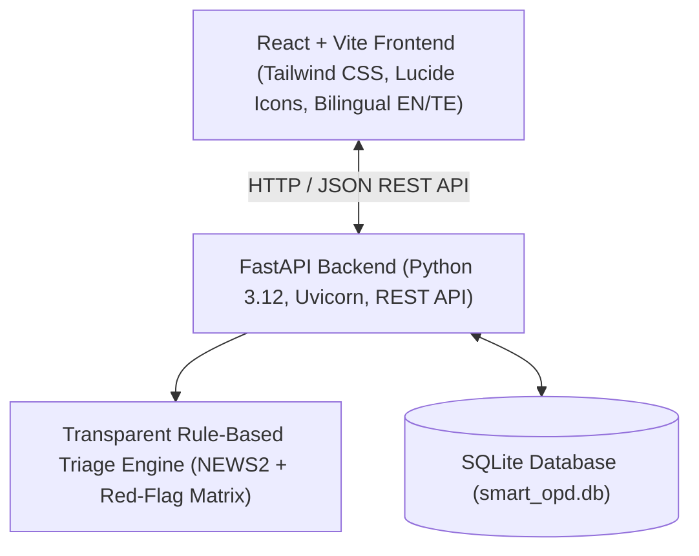

# SmartOPD – Implementation Plan & Architecture

## Problem Statement & Context
**H1 – OPD Triage Assistant for an Overloaded Government Hospital**
In Indian government hospitals (District Civil Hospitals, AIIMS, Taluk Hospitals), overwhelming daily morning OPD footfalls (often 2,000–5,000+ patients) create unprioritized, chaotic queues. Patients with time-critical emergencies (e.g., myocardial infarction, severe asthma, pediatric septic shock, acute stroke) frequently wait behind non-urgent routine cases.

**SmartOPD** introduces an intelligent, transparent, rule-driven triage and queue management system with bilingual English/Telugu support, designed for frontline triage nurses and registration desks.

---

## Architecture & Technology Stack

### Backend Components
1. **`models.py`**: Pydantic schemas for patient demographics, vital signs, red-flag checklist, triage results, queue status, and staff overrides.
2. **`triage_engine.py`**: Transparent, deterministic triage logic:
   - **Emergency (Red / అత్యవసరము)**: Severe red flags (chest pain, SpO2 < 90%, SBP < 90 or > 200, HR > 130 or < 45, altered consciousness, severe trauma, active hemorrhage).
   - **Urgent (Yellow / తక్షణము)**: Moderate respiratory distress, SpO2 90-94%, high fever > 102°F with lethargy, acute abdominal pain, severe dehydration, fracture/wound.
   - **Routine (Green / సాధారణము)**: Stable vitals, chronic refills, mild symptoms, routine follow-up.
   - Explainable breakdown of triggers, vital alerts, recommended OPD/Emergency station.
3. **`database.py`**: SQLite database with schema for patients, triage records, queue tickets, overrides, and audit logs.
4. **`main.py`**: Clean FastAPI endpoints (`/api/patients`, `/api/triage/assess`, `/api/queue`, `/api/queue/{id}/override`, `/api/queue/{id}/status`, `/api/stats`, `/api/reset-seed`).
5. **`sample_data.py`**: Fictional realistic Indian patient cases pre-populated for live demonstration.
6. **`test_api.py`**: Automated test suite verifying triage accuracy, priority ordering, and override handling.

### Frontend Components (React + Tailwind CSS + Lucide Icons)
1. **Bilingual Engine (`i18n.js`)**: Comprehensive English and Telugu strings for medical terms, UI labels, triage prompts, and token slips.
2. **Home Dashboard**: Live operational KPI cards, priority distribution, hourly queue trends, department load indicators, emergency alert banners.
3. **Patient Registration**: Frontline intake form with demographic validation, symptom picker, and vitals entry with instant color-coded normal/warning badges.
4. **Triage Assessment**: Structured red-flag checklist grouped by category (Cardiovascular, Respiratory, Neurological, Pediatric/Geriatric, Trauma/Bleeding).
5. **Triage Results & Token Generator**: Color-coded provisional priority card, transparent trigger explanation, mandatory clinical verification notice, and printable bilingual OPD token/slip modal.
6. **Live Patient Queue Board**: Real-time sorted queue (Emergency > Urgent > Routine, FIFO within tier), department filters, staff priority override modal, audio chime callout, status flow (Waiting -> In Consultation -> Completed).
7. **Admin Dashboard**: System metrics, queue wait times, doctor counter allocation, override audit logs, and seed reset utility.
8. **Hospital Aesthetics**: Government health mission theme (Deep Navy `#0f294a`, Healthcare Cyan `#0284c7`, Emerald Green `#059669`, Warning Amber `#d97706`, Emergency Crimson `#dc2626`), clean card layouts, crisp typography, and mobile responsiveness.

---

## Verification & Testing Plan
- Backend unit and integration tests using `pytest` and `httpx`.
- Browser UI testing verifying registration, triage evaluation, queue sorting, priority override, language toggling, and token slip printing.
